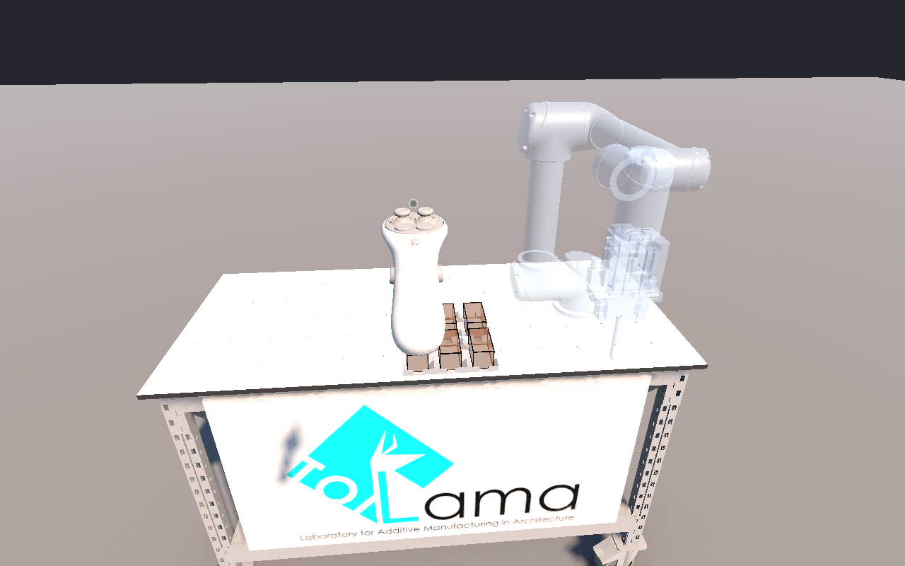
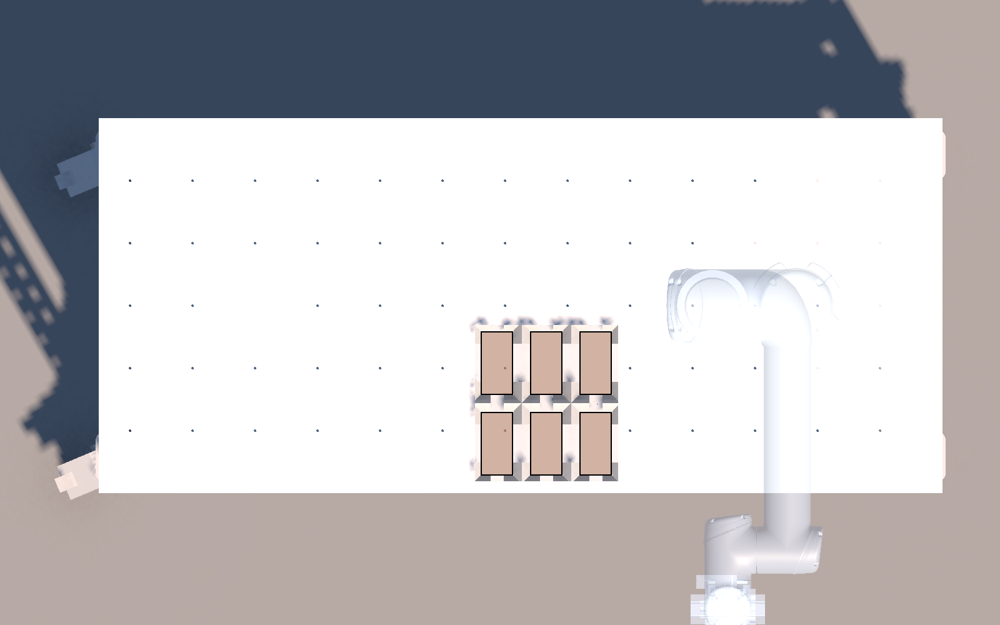
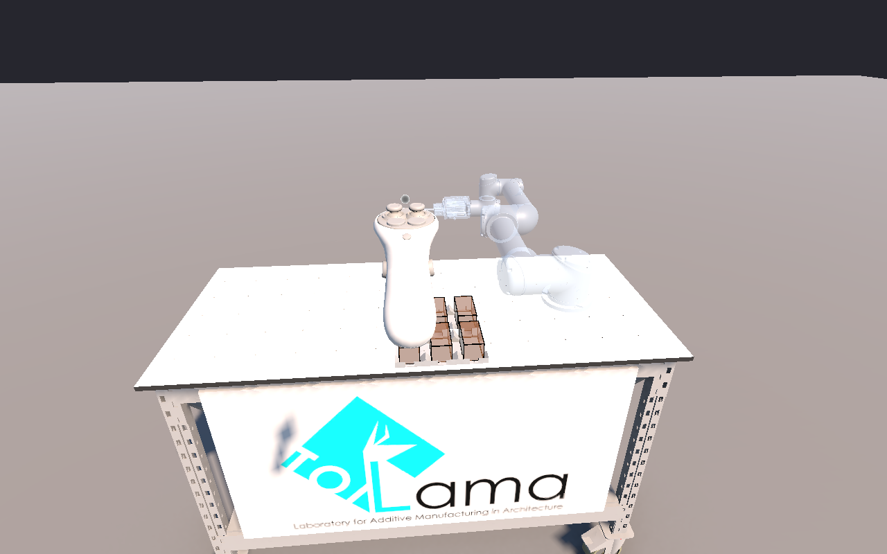

# PicoBricks – Development Log

AR layer of the Creative Robotics group project (TU Delft, ARIT1507, Oct 2026).
**Idea:** a user places timber bricks in AR on the real table, previews the result, and a UR5 robot then builds the same layout.

This log records every step, what worked, what didn't and why decisions were made, so the whole team can follow along and continue the work.
Newest entries are at the bottom. Each entry ends with **Worked / Didn't work / Still to do** where relevant.

| Who | Task (week of 12 Oct) |
| --- | --- |
| Parjanya Singh + Jin Kim | Virtual environment on the Pico headset (this repo) |
| Matthias Nahum | Robot arm moves blocks to the correct location |
| Suzanne Minkels | Computer vision + Raspberry Pi camera |

---

## Hardware and software

- **Headset:** Pico 4 Enterprise, PICO OS **5.9.9** (Aug 2024), Android 10 / API 29. Borrowed, so we don't update its firmware.
- **Robot:** UR5 CB3, bolted to a table, in the LAMA Lab until the last week, then moved to the exhibition space.
- **Unity:** **6000.3.8f1** (same version as the lecturer's HANDZONe project), URP, Android build target.
- **Packages:** PICO Integration SDK **2.5.0** (git tag `release_2.5.0`), XR Interaction Toolkit 3.4.0 + Starter Assets sample, TextMesh Pro essentials.

---

## 2026-10-09 (Fri): Getting the tools working

### Unity Hub + Editor
- Installed Unity Hub (x64, the laptop has an AMD Ryzen CPU).
- HANDZONe is pinned to Unity **6000.3.8f1**, so we installed exactly that instead of the newest version (opening it in a newer one would upgrade and possibly break the project).
- **Didn't work:** the first install was incomplete. Android Build Support was missing and the Hub showed no "Add modules" option (its `modules.json` was missing).
  **Fix:** Remove from Hub → delete `C:\Program Files\Unity\Hub\Editor\6000.3.8f1` → reinstall with **Android Build Support + OpenJDK + Android SDK & NDK Tools**, keeping the Hub open until it finishes.

### Lecturer's HANDZONe repo (https://github.com/newmedia-centre/handzone)
- Cloned with Git LFS (~6 GB). Opened `unity/` with **Add project from disk**.
- Safe Mode prompt (compile errors: `SocketIOClient` missing) → clicked **Ignore** so NuGetForUnity could download the C# libraries. Safe Mode would block that.
- Missing prefabs (UR Pendant, SliderPanel, XR Origin): the repo ignores `Assets/Samples`, so the XR Interaction Toolkit **Starter Assets** sample had to be imported via Package Manager.
- Declined the Meta XR Simulator update (would change the project's package versions).
- **What HANDZONe is:** TU Delft New Media Centre's system to control UR robots from VR:
  Unity app (with a live UR5 "digital twin") ⇄ server in Docker (login, sessions, robot connection) ⇄ real UR5 or URSim (simulated robot).
  It targets Meta Quest, so we use it as **reference and a source of parts** (UR5 model, table model, robot commands), not as our main app.

### Headset connection
- Connect using given C-TYPE cable

### New project: PicoBricks
- **Decision:** build the Pico app in a **small fresh project** instead of inside HANDZONe. HANDZONe is large and set up for Quest; debugging a new headset inside an unfamiliar big project is hard. Robot parts get copied in later.
- Template: Universal 3D. Added the PICO SDK (git URL) and XR Interaction Toolkit to `Packages/manifest.json`.
- PICO SDK window → **Apply All** (Android, API 29, IL2CPP/ARM64, PICO XR plugin). Project Validation → **Fix All** (floor tracking, `PXR_Manager` in the scene).
- **Signing key** (the app's "name tag"; the Pico only installs signed apps): Player → Publishing Settings → Custom Keystore → created `user.keystore` in the project root, alias `picobricks`. Unity forgets the password on every restart, so re-enter it before building. **The keystore is not in Git**; ask Jin for it.
- Package name `com.lama.picobricks`.
- ✅ **Worked:** first build (Ctrl+B), a grey cube floating in the headset.

---

## 2026-10-10 (Sat): Grabbing bricks

- Wrote `Assets/Editor/BrickSceneSetup.cs`: menu **PicoBricks → Setup Brick Scene** builds the whole scene in one click, so nobody has to set up 50 things by hand and teammates get an identical scene.
  It swaps the plain XR rig for the Starter Assets rig (controller ray + grab), adds a floor, table and bricks with physics (`Rigidbody`) and grabbing (`XRGrabInteractable`).
- Grab settings: `throwOnDetach = false` (put bricks down gently instead of throwing them) and `useDynamicAttach = true` (hold the brick where you grabbed it).
- Needed: Window → TextMeshPro → **Import TMP Essential Resources** (validation error from the Starter Assets).
- ✅ **Worked:** picking up and stacking bricks in VR.
- Feedback from testing: rotating bricks is hard, positioning is fiddly, need a reset → reset added (X button); rotation/snapping still to do.

### Passthrough (seeing the real room)
- Added `Assets/Scripts/Passthrough.cs` and `Assets/Scripts/BrickControls.cs` (left controller **X** = reset bricks, **Y** = passthrough on/off).
- **Didn't work, attempt 1:** black background, X/Y did nothing.
  - Buttons: Input System action bindings didn't fire on the Pico → switched to `UnityEngine.XR.InputDevices` (`primaryButton` / `secondaryButton`), the same API the PICO SDK uses internally. ✅
  - Passthrough: requested too early → wait 1 s after start. Still black.
- **Didn't work, attempts 2–3:** the app requested passthrough (log: `passthrough ON`, manifest has `enable_vst=1`), but the headset's camera service never started.
  **Cause:** headset firmware 5.9.9 is older than PICO SDK 3.x expects (release notes mention 5.13+).
  **Decision:** the headset isn't ours, so instead of updating the firmware we **downgraded the PICO SDK to 2.5.0**, the release from just before the firmware (same script IDs, so the scene and settings carried over).
  Leftover SDK 3.4 debugger files were moved to `_backup_pico_sdk34_debugger/` (not in Git).

---

## 2026-10-11 (Sun): Passthrough and placing the table in the real room

- With SDK 2.5 the camera service **did** start, but the view was still black.
  **Cause:** URP's HDR colour format (R11G11B10) has **no alpha channel**, so the "transparent" background was painted solid black.
  **Fix:** `Passthrough.cs` turns HDR off on the camera while passthrough is on. ✅ **Worked:** real room visible, Y switches VR ↔ passthrough.
- **Didn't work:** in passthrough the table floated above my head. Logs showed head height 1.1 m in VR but ~0.1–0.2 m in passthrough: switching passthrough on this firmware **shifts the tracking height by ~1.15 m**.
  - Re-requesting floor tracking: no effect. Moving the rig to compensate: unreliable, made Y toggling worse. Both removed.
  - **Decision:** don't trust the headset's floor at all; take all heights from a calibration where you touch the real table.

### Table calibration: `Assets/Scripts/TableCalibration.cs`
- The app has no idea where the real table is: the table is spawned relative to wherever the headset started. Calibration fixes that.
- v1: touch 2 front corners. ✅ worked on my desk at home, but:
  - **Bug:** bricks dropped off the table fell forever, and bricks lifted high rested on an "invisible shelf". **Cause:** the invisible floor stayed at the headset's (wrong) floor height, ~37 cm above my desk. **Fix:** the floor is now part of the `Workspace` group and moves with the table; bricks that fall >3 m are put back.
  - **Bug:** table height dropped ~1 m with every calibration. **Cause:** the Starter Assets rig has **gravity and locomotion** (made for VR games); "I" fell onto the moved floor. Thumbsticks could also move/turn the world. **Fix:** setup script switches off Move, Gravity, Turn, Teleportation, Climb, Grab Move and the CharacterController. In AR the virtual world must stay locked to the real room.
- v2 (current): **4 points**, right controller **B** to start, white ball = measuring tip, **trigger** to record:
  1. front-left corner, 2. front-right corner, 3. back-left corner, 4. the floor.
  The virtual table copies the real width, depth, height and direction; the floor goes where you touched it. The label shows the measured size to compare with a tape measure.
- ✅ **Worked** on my (messy) desk. Still to do: test on a clean table at uni.
- Known limitation: after toggling Y, re-calibrate (tracking height jump).

### Decisions and open questions
- **Robot pickup:** the robot picks bricks from a **fixed, repeatable spot**. Plan: a 3D-printed holder/tray with chamfered pockets that self-centre the bricks, pinned to the table; the soft gripper should tolerate a few mm. Matthias teaches the position once. Computer vision for finding loose bricks can come later.
- **Headset ↔ robot registration:** the table is bolted to the robot, so 3 marks on the table have **fixed robot coordinates**. Measure them once in the lab (jog the robot tip to each mark), then each session touch the same marks with the controller. This also works after moving to the exhibition hall. Computer vision (marker seen by the headset camera) is a possible upgrade; needs Pico Enterprise camera access (untested).
- **AR → robot interface:** an ordered list `(brick_id, x, y, z, yaw)` in robot coordinates (note: Unity is Y-up left-handed, UR is Z-up right-handed). Transport and format to agree with Matthias.
- **HANDZONe parts to reuse:** UR5 model (live digital twin from joint data), table model (`Meshes/Table.fbx`), robot commands (MoveL/MoveJ, tool digital out for the gripper, program playback for previews). Open question for Matthias: drive the robot through HANDZONe's server or through their own script?
- **Sharing:** Git + GitHub (not OneDrive: syncing Unity's Library folder corrupts projects).

### Version control
- Set up Git for this project. Everything up to here is in the first commit; this log is the record of how we got there.
  From now on: one commit per working step, with a short note on what was tested.

### Real brick size (in progress)
- Bricks are **5 cm wide × 5 cm high × 10 cm deep**, **10** of them: two rows of five near the front edge, long side pointing away from the user.
- Weight not measured yet; estimate 0.13 kg (0.25 L of timber at ~500 kg/m³). Change `BrickMass` in `BrickSceneSetup.cs` once weighed.

---

## 2026-10-13 (Tue): Grid snap (Parjanya)

### Setting up a second laptop
- Cloned to `C:\dev\PicoBricks` (outside OneDrive), Unity **6000.3.8f1** + Android modules. No keystore yet, so Custom Keystore unticked locally (not committed).
- **Didn't work:** Build And Run built fine every time, but the install step kept failing (`Could not find any valid targets to launch on for Android` / `Failed to find device ... in 'adb devices'`), even right after Unity listed the headset as `Pico A8110`. Suspects: USB debugging not approved for this laptop, headset sleeping when taken off, or another adb (PICO Developer Center / Meta tools) fighting Unity's. Workaround: install `001.apk` by hand.

### Grid snap: `Assets/Scripts/BrickSnap.cs`
- Goal: layouts the robot can actually build, i.e. exact, discrete positions instead of wherever physics drops a brick.
- On release over the table (`selectExited`, after XRI has finished dropping):
  1. **Turn** to the nearest 90° (long side away from you or sideways).
  2. **Grid**: the brick's front-left corner snaps to a **5 cm** grid in the `Workspace` frame (origin = middle of the table's front edge), so edges line up between bricks of either orientation.
  3. **Height**: a box sweep straight down finds the table or the brick below; height is rounded to whole 5 cm layers.
  4. **Lock**: Rigidbody goes kinematic; physics only while held. Grabbing a placed brick unlocks it.
- Released off the table (footprint not fully on it): back to its start spot. **X** reset also unlocks placed bricks (`BrickControls.PutBack`).
- Each placement logs `x, z (cm), layer, yaw`, which is the start of the `(brick_id, x, y, z, yaw)` list for Matthias.
- `BrickSceneSetup.cs` adds `BrickSnap` to every brick and wires `workspace` + `table`. Re-run **PicoBricks → Setup Brick Scene** after pulling.
- Known limits: lifting a brick out of the middle of a stack leaves the ones above floating (they're locked); a brick half over the table edge counts as off the table.
- **Still to do:** test in the headset (gaps, rotations, stacks of 3, off-table return, X reset, snapping after B calibration).

### Grid snap v2 (same day, after testing v1 in the headset)
- v1 test findings (installed by hand, `001.apk`):
  - **Floating:** take a brick out from under a stack and the ones above stayed in mid-air (they were locked).
  - **Half-brick offset:** a brick on top of another often landed half a brick off. Cause: v1 snapped edges to a 5 cm grid, which is half a brick length, so a "brick-wall" offset was a valid position. Not what we want for robot towers.
  - Bricks could only lie flat.
  - 10 bricks were more than needed.
- v2 changes (`BrickSnap.cs`, `BrickSceneSetup.cs`, `BrickControls.cs`):
  - **6 bricks**, one row along the front edge.
  - **Lying or standing:** on release, if the brick's long axis is within 45° of vertical it stands (5 × 5 cm footprint, 10 cm tall); otherwise it lies flat. Yaw still snaps to 90°.
  - **Centred stacking:** released over a placed brick, the new brick is centred on it (same orientation: exactly on top; turned 90°: centred across). On the bare table the 5 cm grid still applies. `BrickSnap.AlignToBelow = false` brings back grid-only (half-brick offsets allowed), ready for a button that toggles it.
  - **Heights** are now the exact top of whatever is below (rounded to 5 cm) instead of "layers", so standing (10 cm) and lying (5 cm) bricks mix correctly.
  - **No floating:** when a placed brick is picked up, every placed brick (lowest first) sweeps straight down and drops onto whatever is left below it. X reset now also clears the placed state.
- Each placement now also logs lying/standing, which the robot list needs.
- **Still to do:** test v2 in the headset (stack aligned, crossed stack centred, standing brick on table and on a brick, pull the middle brick of a 3-stack, X reset).

---

## 2026-10-14: 3D-printed pickup trays

- **Problem:** the robot needs every brick to start in exactly the same spot. **Decision:** 3D-printed trays (PLA, Bambu A1), fixed to the robot table with double-sided tape.
- Generated in **Rhino 8 by a script** (`hardware/pickup-tray/make_tray.py`) instead of modelling by hand: exact, and easy to change (clearance, slot widths) by editing numbers and re-running. Output: STL files ready for Bambu Studio. Details, print settings and pocket coordinates: [`hardware/pickup-tray/README.md`](../hardware/pickup-tray/README.md).
- Design choices:
  - **Two trays** (6 + 4 pockets), because 10 don't fit on the 256 × 256 mm bed.
  - Bricks held at the **corners only**, with a 45° lead-in so they self-centre; **open slots on every side** because we don't know the gripper's finger size yet.
  - **Engraved numbers 1–10** = brick IDs; **3 crosshairs on Tray A** = shared reference points for the robot and the AR calibration.
- **Didn't work at first:** Rhino booleans failed (some cutting shapes were inside-out, and pocket boxes fully inside the tray can't be subtracted on their own). **Fix:** flip shapes to face outwards, merge all cutters into one, then subtract once.
- Still to do: print a test pocket and check the fit with a real brick; adjust slots once Matthias knows the gripper.

**Revision (same day):** we only use **6 bricks**, and the trays used too much filament (436 cm³ for both).
- Now **one tray** (3 × 2 pockets, 229 × 250 mm, fits the A1 bed) and **minimal**: a 1.6 mm frame with open windows (bricks stand on the table), plus L-shaped corner pieces with a 3 mm lead-in. **76 cm³**, about 6× less plastic.
- Numbers 1–6 and the 3 crosses moved onto the frame. Old two-tray files removed (still in Git history).
- Unity: `BrickCount` = 6, 3 per row.

**Clearance 0.5 → 1.0 mm per side** (pocket 52 × 102 mm). Reasoning: timber varies by ±0.5–1 mm and swells with humidity, printed inside sizes come out 0.1–0.3 mm small, and a snug brick could drag the taped tray or make the soft gripper slip. 1 mm per side still keeps the brick within ±1 mm (~1° rotation), which the gripper tolerates.
Added `test_fit_clearance_0.5-1.0-1.5.stl`: three small frames to try real bricks before printing the full tray.

**After printing the test frames:**
- ✅ **0.5 mm per side fits the real bricks well**, so the tray went back to 0.5 (pocket 51 × 101 mm, pitch 79 × 129 mm). The 1.0 mm worry turned out unnecessary for these bricks.
- ❌ The lead-in only covered the inner 3 mm of the 4 mm corner wall, leaving a flat ledge a brick could rest on. **Fix:** the 45° slope now starts at the **outer top edge** of each corner piece, so a brick landing on a corner slides into the pocket.
- ❌ The test frames only had 2 (diagonal) corner pieces. **Fix:** the test frame now has all 4, same as the tray (`test_fit_0.5.stl`).

---

## 2026-10-15: Merged Parjanya's grid snap into main

- Parjanya's branch `snap-grid` (Pull Request #1: grid snap v1 + v2) merged into `main` together with Jin's pickup-tray work.
- Three small clashes, resolved: `.gitignore` (kept both additions), `BrickSceneSetup.cs` (kept Parjanya's 6 bricks in one row + measured weight 0.12 kg), `README.md` (kept both).
- Checked: the merged project compiles (Unity batch mode, no errors). **Not yet tested in the headset.**
- New headset (same model, different unit) arrived; needs developer mode + USB debugging, then check its firmware version (decides which PICO SDK works, see 2026-10-10).
- Next: the project is changing direction: **draw a line in AR + set layer height → bricks stack themselves into a wall → robot builds it.** To be discussed with the team.
- Tagged this state as **`v1-manual-placement`** (GitHub → Tags), a permanent bookmark of version 1 before the new direction. Same repository from here on; new features go on branches and get merged into `main`.

---

## 2026-10-15: New headset, Pico 4 Ultra Enterprise

- The new headset is **not** the same model: **Pico 4 Ultra Enterprise** (A9210), firmware **5.15.5**, Android 14. TU Delft-managed (their apps are installed; we only ever install/remove PicoBricks). **We use this one until the end.**
- USB debugging was already on and the laptop was already allowed.
- **Decision:** switch back to **PICO SDK 3.4.0**. SDK 2.5 was only chosen for the old headset's old firmware (5.9.9); the Ultra needs SDK 3.0+ and its firmware meets 3.x's requirement (5.14+).
- `Passthrough.cs` now also uses SDK 3.x's official `PXR_Manager.EnableVideoSeeThrough`, keeping the direct calls as a fallback.
- PICO Project Validation on 3.4 suggested: HDR off for URP (same cause as our black passthrough), multiview stereo rendering, SSAO off. Applied.
- Build installed and runs on the Ultra.
- Feedback on grid snap v2 in the headset (Jin): placed bricks no longer follow gravity and some float. Not fixed, because the project moves to the wall-drawing version next; grid snap is switched off there.

---

## 2026-10-15: Version 2, the wall from a drawn line (iteration 1: rectangle)

**The new idea:** instead of placing bricks one by one, the user describes the wall and the app works out where every brick goes. The same list then drives the robot.
1. Calibrate the table (as before).
2. **Draw a line** on the table where the wall should go.
3. **Choose the layer height** (1–3 layers).
4. Press **OK**, and the bricks appear as a wall along the line.
5. (Later) preview with an AR robot, then the real robot builds it.

Two iterations are planned: **rectangle** first (every layer the same length), then **triangle** (3 + 2 + 1 = 6 bricks, each layer shorter).

**Rectangle with 6 bricks:** bricks per layer = 6 ÷ layers, so 1 layer = 6 × 1 (60 cm long), 2 layers = 3 × 2 (30 cm), 3 layers = 2 × 3 (20 cm). Very limited, but enough to get the whole pipeline (draw → plan → AR → robot) working first.

**How it works now (`Assets/Scripts/WallBuilder.cs`):**
- **Drawing:** point the right controller's laser at the table and hold the **trigger**; release at the end. The point is where the ray hits the table top, so you can draw from a comfortable distance. Both ends are kept inside the **build area** (table minus 3 cm, shown as a white outline).
- **Layers:** right **thumbstick** left/right (1–3). The floating text shows the resulting wall, e.g. "3 bricks long x 2 high = 30 cm wall". **A** = OK.
- **Wall:** bricks lie flat, long side along the line, end to end, stacked straight up (no overlap between layers yet). The wall's angle follows the line.
- **"One corner always touching":** the line's **start point is the wall's front corner**, and the wall's front face lies on the line. The wall sits on the side of the line *away from the user*, so the drawn line stays visible along its front.
- The **line's length doesn't set the wall length** yet: with 6 bricks the length comes from the layer count. The line gives the start point and the direction.
- If the wall would stick out of the table, nothing is built and the user is asked to draw again or choose more layers.
- Built bricks are locked in place and can't be grabbed. **Trigger** draws a new wall (bricks go back first), **X** puts all bricks back.
- **Brick list for the robot:** each build is saved as `wall_plan.json` on the headset (`/sdcard/Android/data/com.lama.picobricks/files/`): pattern, layers, and for every brick its build order, layer, position (x, y, z in metres, table frame: origin = middle of the front edge on the table top) and angle (yaw). Also printed to the log. This is the start of the interface with Matthias.
- Grid snap (`BrickSnap.cs`, v1) is **switched off** (`AddGridSnap = false` in `BrickSceneSetup.cs`): it made placed bricks ignore gravity and float, and isn't needed when the wall is generated.

**Open questions for the team:**
- Should the wall be centred on the line instead of starting at it? Should the line's length matter (e.g. spacing bricks out)?
- Should layers overlap like real masonry (half-brick offset)? That changes how many bricks fit per layer.
- Which side of the line should the wall sit on?
- How will the robot get `wall_plan.json`: copied by hand, Wi-Fi, through HANDZONe?

**Status:** compiled; first headset test → see the next entry.

---

## 2026-10-15: v2 after the first headset test: curves, bricks in the tray, readable bricks

**Feedback from the first test (Jin):**
1. It has to be a **curve**, not a straight line. When the curve bends, the bricks must still **touch at at least one corner** and **mimic the curve**, whether the drawn curve is too short or too long.
2. The user doesn't really need to handle the bricks any more, but keep them for now: they should start **in the pickup tray** (the one we designed), fixed at the **front-left corner of the table** after calibration, and still be movable.
3. All bricks look like one big block when built (same colour, no edges). → **Black outline**, **brown at 70 % opacity**.

### The curve logic (`WallBuilder.cs`)
1. **Record:** while the trigger is held, a point is stored every ~1 cm where the laser hits the table (kept inside the build area).
2. **Smooth:** a few passes of neighbour averaging remove hand wobble; the first and last point stay where they were drawn.
3. **Scale to the wall ("mimic"):** with 6 bricks the length of one layer is fixed (6, 3 or 2 bricks). The curve is scaled **about its start point** until its length equals one layer of bricks. A short scribble and a long sweep give the same shape at wall size. The scaled curve is shown after building.
4. **Walk in brick lengths:** from the start, find the point on the curve exactly 10 cm away (one brick length, measured straight), then the next, and so on. Each step is the direction of one brick. If the curve runs out (straight steps are shorter than the curve), the remaining bricks continue in the last direction.
5. **Corner rule:** two straight bricks can't follow a bend exactly: one side gets a gap, the other would overlap. At every joint the bricks share the corner **on the inside of the bend**:
   - curve bends away from the wall body → they share the **front** corner (gap opens at the back);
   - curve bends towards the wall body → they share the **back** corner (gap opens at the front).
   So they never overlap and always touch at one corner.
6. **Layers (rectangle):** every layer repeats the same chain, stacked straight up.
- If any brick corner ends up off the table or on the tray, nothing is built and the user is asked to draw again or choose more layers (= a shorter wall).
- Tunable at the top of `WallBuilder.cs`: point spacing, smoothing passes, edge margin, minimum curve length.

### Bricks start in the tray
- The tray in the scene is the **actual printed tray**: `Assets/Editor/TrayMeshImporter.cs` turns `hardware/pickup-tray/pickup_tray_bricks_1-6.stl` into a Unity mesh (mm → m, Rhino z-up → Unity y-up). Unity can't import STL itself. Re-run **Setup Brick Scene** after changing the tray.
- It sits at the table's **front-left corner** (`TableCalibration` moves it there after calibration; `trayOffset` if the real tray is taped a bit further in). It has a collider, so bricks rest in its pockets.
- The 6 bricks start in its pockets (numbered 1–6 like the print) and can be grabbed and moved. **X** puts them back into the tray; building a wall takes them from the tray (like the robot will).
- The drawing area now excludes the tray (starts 3 cm to the right of it).

### Readable bricks
- Brick material: URP Lit, **transparent**, brown (0.55, 0.36, 0.20) at **70 % opacity** (`Assets/Materials/BrickTransparent.mat`).
- **Black 2 mm outline** on all 12 edges: a small mesh of 12 thin boxes (`Assets/Models/BrickOutline.asset`, made by the setup script) as a child of every brick, unlit black, rendered from both sides.

**Status:** ✅ tested in the Pico 4 Ultra (15 Oct): curves, tray and readable bricks work ("this is good", Jin).

---
### Curve fix (2026-10-18): bricks drifted off S-curves (found by Jin)
- **Problem:** in an explanatory drawing of an S-curve, Jin noticed the bricks didn't sit on the 10 cm points: brick 2 had a point at its back, brick 3 in its middle.
- **Cause:** the points on the curve only set each brick's *direction*; positions were chained from brick to brick. Whenever a joint had to hinge on the **back** corner (curve bending towards the wall body), that brick started off the curve, and every brick after it inherited the shift.
- **Fix:** keep the two rules (step one brick length along the curve, hinge on the inside corner of the bend), but aim every brick **from where it really starts**, so its front end lands back on the curve. A shift from a back-corner hinge is corrected by the next brick instead of carried along. (`WallBuilder.cs`, `StepAlong`.)
- Explained with two analogies: **dividers** set to 10 cm stepping along the curve, and bricks joined like a **folding ruler** with the hinge on the inside of each bend.

---

## 2026-10-15: Pickup tray, big slopes that meet in a ridge

- Problem with the printed version: the lead-in slopes were small (only on the 4 mm corner pieces), so a brick could still land on top of a corner instead of sliding in.
- **Change:** the corner pieces now **fill the gap between neighbouring pockets**, and their **45° slopes start in the middle of the gap**, so the slopes of neighbouring pockets **meet in a ridge**. Wherever a brick lands near a pocket, it slides down into it. Where four pockets meet, the slopes form a small roof.
- Still: all 4 corners per pocket, 0.5 mm play per side, open slots in the middle of each side for the gripper, numbers 1–6.
- Tray is now 229 × 250 × **19.8 mm** (6 mm straight wall + 13.8 mm slope), about 200 cm³ if solid (more plastic than the thin version, because of the big slopes).
- Calibration crosses moved onto the flat frame in the gaps beside the pockets, because the old spots are now under the ridges: (75, 60.5), (154, 60.5), (75, 189.5).

---

## 2026-10-18: Headset → laptop → RoboDK / UR5 link (Parjanya, branch `robot-link`)

- Built on `wall-builder`. **No existing files changed** except `.gitignore` and this log, so it merges cleanly.
- `Assets/Scripts/BrickSender.cs`: adds itself at startup (no scene edit). A few frames after **A** (WallBuilder's OK) it sends, over Wi-Fi (UDP 5005, JSON), every brick that left its tray pocket: **pick** = its pocket, **place** = its wall spot, both in the table frame, plus a `standing` flag. Pick spots are worked out at send time, because the tray moves after calibration. No headset: **S** in Play mode.
- `robot-bridge/`: `picobricks_bridge.py` + `PICOBRICKS.bat` on the laptop. It converts to robot coordinates with `calib.json` (robot TCP on the table's front-left + front-right corners, the same corners the headset uses), then simulates in RoboDK (bricks ride with the gripper) and runs on the UR5 via RoboDK or plain URScript. See `robot-bridge/README.md`.
- Gripper (not suction): output, close value, grasp depth and finger direction are settings at the top of the script; **to agree with Matthias**.
- Relation to `tcp-receiver` (Matthias, Unity → Grasshopper): the two routes do the same job. Pick one for the exhibit.
- **Status:** bridge tested against a mock RoboDK. Not yet compiled in Unity or run in the headset.

---

## 2026-10-18: Everyone's work merged into main

**State of the branches before merging:**
- `main`: Matthias's (GitHub: manah-882) **CSV exporter**, merged via Pull Requests #2/#3 on 16 Oct. `BrickCsvExporter.cs` writes `scene_objects.csv` (table + every brick: position, rotation, size in the table frame, axes swapped for Rhino). Also a separate test scene `Assets/scene.unity` (built on the old 10-brick version).
- `wall-builder` (Jin): version 2, walls from a drawn curve, plus the curve fix.
- `robot-link` (Parjanya): headset → laptop → RoboDK/UR5, built on top of `wall-builder` (entry above).
- `tcp-receiver` (Matthias): README notes for a live Unity → Grasshopper link (port 5000). The sender script and Grasshopper file aren't on GitHub yet, so this branch is **not merged**.

**What was done (safe order):**
1. Bookmark tag **`before-robot-link`** on main, so the pre-merge state is always one click away.
2. Merged `wall-builder` → main. The only clash was `README.md`, and it was only line endings (the CSV merge had re-saved the file with Windows line endings); kept the up-to-date README.
3. Merged `robot-link` → main. Same line-ending clash in `.gitignore`; kept main's file and added robot-bridge's per-session files.
4. Removed the Visual Studio project files (`*.csproj`, `*.sln`) from Git again. They're generated by Unity on every laptop and were uploaded by accident; they're already in `.gitignore`.
5. **Compile check of the merged project (Unity batch mode): `BrickSender.cs` didn't compile** (`InputDevice` and `CommonUsages` exist in both Unity's XR and Input System namespaces). Fixed by naming the XR ones explicitly. Now compiles with no errors.

**Decisions still open (team):**
- **Robot route:** Parjanya's (Python bridge → RoboDK → UR5, complete chain incl. tray pick and robot calibration) or Matthias's (Unity → Grasshopper → Robots plugin, robot part not built yet). Jin's suggestion: Parjanya's route drives the robot; the bridge could also forward to Grasshopper for Matthias. Merging `robot-link` is reversible (tag above, or revert).
- **One brick list format:** `wall_plan.json` (WallBuilder), `scene_objects.csv` (CSV exporter) and the UDP message (BrickSender) now all exist. Suggestion: keep BrickSender's (pick + place per brick) as the main one.
- **Not built yet: the robot in AR.** The lecturer's key point (via HANDZONe) is seeing the machine build the wall *in the headset* before the real robot moves. RoboDK shows it on the laptop only. Next big step: a ghost UR5 in the headset that animates pick and place for every brick.

---

## 2026-10-19: First headset → laptop test of the robot link

- Rebuilt the app with `BrickSender`; RoboDK installed on Jin's laptop (it brings its own Python, so `PICOBRICKS.bat` now uses that first).
- No hotspot needed at home: headset and laptop on the same Wi-Fi, and `BrickSender` also broadcasts, so the laptop received it.
- ✅ **Headset → laptop works:** drew a curve, pressed A, and the bridge (menu 3) printed all 6 bricks with pick (tray pocket) and place (wall) in robot coordinates.
- ❌ RoboDK step failed: "Invalid item provided". Cause: RoboDK had been reopened (station without a UR5) in the hours since the listener started, so the bridge's stored robot handle was dead. **Fix:** the bridge now reconnects before each run. Load the UR5 again and replay with menu 4 (`last_layout.json`) or press A again in the headset.
- Then "Target cannot be reached": the placeholder put the table 75 cm from the robot, and the tray (at the front-left corner of Jin's ~1.3 m wide desk) ended up 83-88 cm from the base. The UR5 reaches 85 cm at most, less with the tool pointing down. Placeholder moved to 55 cm (`calib.example.json`) → ✅ **RoboDK built the whole headset wall** (6 bricks).
- **Lesson for the real setup:** tray and build area must stay within ~60-70 cm of the robot base. Position the tray deliberately within reach on the robot's table, and limit the drawing area to the reachable zone later.
- Still placeholder `calib.json`: the real positions need the corner measurement at the robot (menu 5).
- **RoboDK showed an older wall than the headset** ("the curve is noticeably wrong"). Checked step by step: headset wall plan = what was sent = where RoboDK put each brick (to the mm). So the data was right; RoboDK was just behind. Causes: (1) in simulation the bridge waited for "y" before every wall, so a new wall from the headset sat unbuilt; (2) duplicates were filtered by number only, and the headset restarts its numbering when the app restarts. **Fix:** only true duplicates are skipped (same number within 2 s), and walls queued during a build are skipped in favour of the newest (tested with fake headset messages). Building straight away without asking was tried and **reverted at Jin's request**: the "Run? [Y/n]" question gives the user time to take the headset off and watch the screen. So: answer the question in the black window for each new wall.

## 2026-10-19: Ghost UR5 + LAMA table in the AR scene (step 1 of "see the robot build it first")

The lecturer's requirement: the user **sees the UR5 build the wall in the headset and confirms before the real robot moves**. Chosen route (**route B**): RoboDK on the laptop plans the robot's joint movements (via Parjanya's bridge), sends them back to the headset, and a see-through "ghost" UR5 acts out the pick and place there. The user confirms in the headset; the laptop's "Run? [Y/n]" stays as a second check. This entry is step 1: the ghost robot standing in the right place.

**Set-up (confirmed by Jin):** the real robot is on the **LAMA table** (the one in HANDZONe's model). The user stands at the **long side**, with the robot on the **right**.

What **PicoBricks → Setup Brick Scene** now does:
- Places HANDZONe's **LAMA table + UR5 + gripper** (`Assets/ThirdParty/HANDZONe`, see `HANDZONE_NOTES.md`) in the Workspace. It measures the table model itself: long side = front edge (where the user stands), robot end = right, front-edge middle on the table top = the Workspace origin (same frame as calibration, the wall plan and the bridge). Measured: **1.43 × 0.61 m, 0.91 m high; UR5 base 0.47 m right of the middle, halfway back** (0.31 m from the front edge).
- The **robot is pale blue and see-through** (`GhostRobot.mat`). The **LAMA table model only shows in VR mode**: in passthrough you see the real table. The old grey box table stays invisible, only for its collider and size. It now gets the LAMA size by default.
- The **pickup tray moved next to the robot**: along the front edge, its centre 40 cm left of the robot base (all pockets within ~60 cm of the base). `TableCalibration.trayOffset` keeps it there after calibrating. Pick positions sent to the robot follow automatically (`BrickSender` reads the tray's position).
- New script **`GhostRobot.cs`**: poses the arm with the same 6 joint angles the real UR5 and RoboDK use (`SetJointsDegrees` / `SetJointsRadians`), and answers "can the robot reach this point?" (`InReach`: between 18 and 70 cm from the base, measured on the table).
- **`WallBuilder`** now refuses walls that are **out of the robot's reach** or **land on the tray** (message says which), and draws the robot's reach as an **orange arc** on the table. The build area is the whole table minus 3 cm (it used to be "right of the tray", but the tray isn't at the left corner any more).

**Joint angle check (found while testing):** HANDZONe's model at "all joints 0" stands upright (the "candle"), but the real UR5 at all zeros lies flat, stretched out. So the shoulder and wrist 1 are shifted by 90°: `GhostRobot.zeroOffset = (0, 90, 0, 90, 0, 0)`. Checked with renders of three known poses (below). Still to check against RoboDK: same joint numbers → gripper at the same spot (directions of base and wrists).

| Home pose (tool down) | Top view (tray left of the robot) | All joints 0 (arm flat) |
| --- | --- | --- |
|  |  |  |

(Rendered by Unity without the headset, in VR mode: the controller in the middle is the rig's controller model at its default spot.)

**Batch set-up:** `BrickSceneSetup.SetupFromCommandLine` runs the set-up without opening the Unity window (`Unity.exe -batchmode -quit -projectPath <PicoBricks> -executeMethod BrickSceneSetup.SetupFromCommandLine`).

**Note:** the measured table is the HANDZONe model's. Calibrating on the real table still resizes the invisible table box, but the ghost stays at the model's size, centred on the front edge. If the real LAMA table differs, we'll see it as an offset and can fix it then.

**Next:** build onto the headset and check the ghost stands on the real robot. Then the bridge sends RoboDK's joint movements back, the ghost animates pick and place with ghost bricks, and the user confirms in the headset.

## 2026-10-19 (afternoon): Drawing area, tray in the corner, and the ghost robot builds the wall

**First headset test of the ghost (at home):** the robot, tray and messages showed up. But the reachable drawing spot (behind the tray, next to the robot) was awkward, and the orange reach arc didn't make clear where to draw. Jin: move the tray to a corner where the robot can still reach it, leave room for drawing, and put a **black line around the drawing area**.

- **Tray:** the real corners next to the robot are taken by its own base (an arm can't pick that close to itself), and the left corners are out of reach. So the tray now sits in the **back corner beside the robot** (right edge 16 cm left of the base centre, 3 cm from the back edge).
- **Drawing area:** a **black rectangle in front of the tray, on the user's side**: from the front edge to just before the tray, the left edge where the robot's reach ends, the right edge 20 cm before the robot. On the LAMA table that's about **44 × 27 cm**. The laser drawing stays inside it. The orange arc was removed; the reach check still runs as a safety net (`WallBuilder.drawArea`, computed in `BrickSceneSetup`).
- Jin's observation: the robot can probably reach much more than this. True: 70 cm reach and the rectangle are cautious guesses. **To do later:** measure the real reach (with the gripper) and let the area follow it.

**Headset → laptop → headset: the ghost robot builds the wall** (route B, step 2):
1. **A** in the headset: `BrickSender` sends the bricks (pick + place) **plus where the ghost robot stands** and a few of its test poses.
2. The bridge works out every joint angle of the robot's moves (go above the tray pocket, straight down, grip, up, over to the wall, down, release, ...): the same moves the robot will make. About 200 poses for 6 bricks.
3. It sends them back to the headset (**UDP 5006**). **`GhostPlayer.cs`** puts the bricks back in the tray and the ghost picks them up and builds the wall, with a progress label above the robot ("picking Brick_3 (3/6)"). At the end: "On the laptop: Run? [Y/n]".
4. ✅ **Worked in the headset on the first try** (Jin, at home).

**Why not RoboDK (decision, 19 Oct, Jin):** RoboDK's trial licence on Jin's laptop had expired. The free licence refuses most commands from our script ("API calls are limited"), so it couldn't work out the ~200 poses. Options were (A) find a TU Delft RoboDK licence, or (B) do the UR5's joint maths ourselves. **Chose B**: `robot-bridge/ur5_kinematics.py`, the standard closed-form UR5 solution (Hawkins 2013), plain Python, no licence, works on every laptop. Tested: 2000 random poses, 0.000 mm error; with a fake headset, every brick picked and placed within 0.1 mm. Bonus: the ghost shows exactly the joint angles the real robot will get, because the same maths produces both. RoboDK's laptop simulation (menu 1 and 4) now needs a licence; menu **3** = ghost robot in the headset, no RoboDK.

**Lining up the ghost and the maths automatically:** the headset sends which way the ghost's arm points at "all joints 0" and with the base turned 90°. The bridge compares that with the maths and turns its robot to match. It also compares the ghost's hand position for 3 test poses with the maths and prints either "ghost robot matches the UR5 maths" or a warning that a joint turns the wrong way.

**Bug found on 20 Oct (Jin):** "the robot can't reach…" for every wall, and in the headset the tray seemed to sit on the robot base. It really did: the nearest pocket was 9 cm from the base. Cause: the ghost robot is placed from the **middle of the front edge**, but the tray was placed from the **front-left corner**. When the calibration measured a narrower table than the LAMA model (1.43 m), the tray slid sideways into the robot. **Fix:** with the ghost robot, the tray is measured from the same point as the robot (`TableCalibration.trayFromOrigin`). The bridge's message now names the brick and the reason ("Brick_3 in the tray, 9 cm from the robot: too close to its base"). Replaying Jin's wall with the tray in the right place: all 207 robot poses OK.

**2-point calibration for the LAMA table (20 Oct, Jin's idea):** Jin has no access to the LAMA table right now and tests on a home table of a different size. Idea: calibrate from one corner and give the table the real size of the table we'll use. Done, with one addition: one point gives the position but not the direction, so it's **2 points**: (1) the **front-right corner** (next to the robot: anchoring there keeps robot, tray and drawing area exactly where they will be), (2) **any point further left on the front edge** (direction; the further, the more accurate). The table gets the LAMA size measured from the model (143 × 61 cm, 91 cm high); no floor point needed. On with the ghost robot (`TableCalibration.fixedSize`); without it, the 4-point calibration that measures the table is still there. At home the virtual LAMA table sticks out past the left end of the desk, which doesn't matter: everything used is near the robot.

**"The bricks can't fit" all the time (20 Oct, Jin), especially with 1 layer:** a 1-layer wall is 60 cm of bricks, the black area was only 44 × 27 cm, and the curve grew from its start point, so it ran off the area. Three fixes:
1. **Real reach instead of a guess:** the UR5 maths (`ur5_kinematics.py`) says the robot reaches **11–81 cm** from its base with the gripper pointing down (checked at grasp and travel heights, 4 gripper angles). Walls may now go **20–75 cm** from the base (safety margin both ends), anywhere on the table, minus the tray. The black line follows that real shape (traced on a 1 cm grid). Area **0.33 m²**, was 0.12 m².
2. **The wall slides into place instead of being refused:** if it pokes out, it is moved (same shape and direction) to the nearest spot where it fits, up to 40 cm, and the message says how far ("moved 12 cm to fit the robot's area"). Only refused if it fits nowhere.
3. **The wall grows around the middle of the drawn curve** instead of from its start point, so it lands where it was drawn.

**Headset test 21 Oct (Jin): 1-layer walls still refused, and bricks overlapping on curves.**
- *Still refused:* the old 44 × 27 cm rectangle was still stored in the scene. The setup had stopped writing it, but never cleared it, and Unity keeps the old value of a reused component. Fixed: the setup now clears it explicitly. (The bigger area from 20 Oct had never actually been active.)
- *Overlapping bricks* on S-curves and sharp bends (screenshot: a 6 × 1 S-curve with bricks cutting through each other). The hinge corner was chosen by a simple rule, and nothing checked the result. Now both hinge corners are tried for every brick, each candidate is checked against all bricks laid so far (separating-axis test; touching is allowed), and the one that lands closest to the curve wins. If none fits, the bend is too sharp for 10 cm bricks and is straightened step by step. Tested outside Unity (Python copy of the logic) on 12 curve types × 1–3 layers × both wall sides: **0 overlaps**, neighbouring bricks always touch.

**Confirm before the robot builds (21 Oct, Jin):** "the robot starts building immediately after I've drawn the line, I can't even see the preview of the bricks; pressing a button to start building would be nice." Also: bricks "not on the same plane" (floating, tilted). Cause of the second one: A was read by two scripts. `WallBuilder` (A = build) and `BrickSender` (**every** A = send the current brick positions). Pressing A while the ghost was building sent the half-moved bricks (some in the tray, one tilted in the gripper) as a new wall, and the ghost then placed bricks there. New flow:
- Release the trigger → the bricks **immediately stand where the wall will be** (preview). The thumbstick changes the layers and the preview updates live. TRIGGER = draw again.
- **A = "happy with it"**: only now the wall is saved and sent to the robot (`WallBuilder.Confirmed` → `BrickSender`). `BrickSender` no longer listens to A itself when there is a wall builder.
- After sending, A does nothing; TRIGGER starts a new wall (and stops the ghost), X puts the bricks back.

**Ready for the real robot (21 Oct):** Jin and Matthias test at the LAMA table today. Bridge changes, all tested against a pretend robot on the laptop (it streams joints like a UR5 on port 30003 and receives URScript on 30002):
- **The real robot gets exactly the ghost's joint angles** (`movej` with joints from the same UR5 maths), not targets that the robot's controller would solve its own way.
- **Reading the robot instead of typing numbers:** menu `c` reads the robot's joints and position (nothing moves) and checks that our maths matches the robot. Menu 5 reads the calibration points straight from the robot (press Enter at each point).
- **Calibration points changed: front-right corner + a point on the front edge.** The robot can't reach the far-left corner of the 1.43 m LAMA table (about 1.2 m from its base); the test caught this. The same two points the headset uses, so robot and headset share one table frame (anchored at the front-right corner, LAMA width).
- **Real robot vs ghost check:** before a real run, the bridge compares where the real robot stands (from the calibration) with the ghost in the headset and warns if they're more than 2 cm or 3° apart.
- **Gripper test** (menu 7), **one-brick test** (menu 8), full wall (menu 9). Menu order in `PICOBRICKS.bat` follows the lab checklist in `robot-bridge/README.md`.
- Unknown until the lab: the gripper's length (`TOOL_LENGTH`, assumed 150 mm), which output drives it, the robot's IP address.
- Wi-Fi note: on eduroam the headset can't reach the laptop (device-to-device traffic is blocked); use the laptop's Mobile hotspot.

**At the LAMA table (21 Oct):** ghost robot works over the laptop hotspot (not eduroam). Headset calibration about 1 cm off, fine for the preview (the robot uses its own calibration). Feedback (Jin + a test user): the measuring ball was hard to find, and users didn't know where they were pointing. Changes: the measuring ball is now **orange, bigger, joined to the controller by a short line, and only shown while calibrating** (prompts say "half sunk into the table": the ball's centre is what's measured); a **laser pointer** (thin cyan line + dot where the curve point will go) shows where you point while drawing.

**Real table measured (21 Oct, Jin):** the LAMA table is **1348 × 600 mm** (the HANDZONe model: 1426 × 611), and the robot's centre is **250 mm from the right end, 300 mm from the front edge** (model: 239 / 311). The tray at the planned spot touched the robot's base plate (it reaches ~15 cm from the centre). Changes: the setup moves the ghost robot to the real spot and uses the real table size (`RealTableLength`, `RealTableDepth`, `RobotFromRightEnd`, `RobotFromFrontEdge` in `BrickSceneSetup.cs`; `LAMA_WIDTH` in the bridge = 1348), the tray keeps 19 cm from the robot's centre. **Tray: 440 mm from the right end, flush against the back edge** (350 mm from the front edge; changed from 30 mm off the back on Jin's request). `test_wall_lama.json` regenerated for these positions.

## 2026-10-21/22: First real brick 🎉
- **Connection:** robot (CB3, Polyscope 3.15) at **192.168.1.2** (pendant: About screen), laptop cable address **192.168.1.100** manual (Windows remembers it). On eduroam the headset can't reach the laptop: laptop **Mobile hotspot** for the headset.
- **Robot check (`c`):** our UR5 maths and the robot's own TCP reading agree to 0.1–1 mm in two very different poses; the pendant's TCP is 151 mm from the flange (`TOOL_LENGTH = 151`).
- **Gripper:** standard digital output **4**, on = closed.
- **Real table:** 1348 × 600 mm, robot centre 250 mm from its short edge and 300 mm from the LAMA-logo edge (the model differed by ~1 cm). Tray 440 mm from the robot's end, flush against the back edge.
- **Robot calibration (menu 5):** the robot's safety limit stops it ~10 mm above the table, so the calibration now asks for the gap (measured with a ruler) and subtracts it. Corner (297.7, 242.5, 7.6) and edge point (298.4, −579.8, 7.5) mm, 82 cm apart, X differs 0.7 mm. Backup: `robot-bridge/calib_LAMA_2026-10-21.json`.
- **Next day (22 Oct):** cable in → `c` connected straight away; **menu 6 hover: still exactly above both points** (no new calibration needed); **menu `t`: the UR5 picked Brick_1 from the tray and placed it in the test wall** with the same joint angles the ghost uses. ✅ First real brick.

**⚠️ Elbow hit the table (22 Oct).** After "start from the robot's real pose", both the ghost and the real robot took an **elbow-down** arm shape (shoulder ≈ 0°, elbow down to −31 mm, wrist flipped), and the arm touched the table before the gripper. Cause: the UR5 can reach a point in up to 8 arm shapes; the maths picks the one closest to the previous pose, and starting from an unusual real pose led it into elbow-down. Fix: `ur5_kinematics.inverse(..., min_elbow_z)` only accepts **elbow-up shapes (elbow ≥ 150 mm above the base) with a normal wrist**; the arm shape is chosen from the known ready pose; the real pose is only the first and last point. Checked on two walls and three different start poses (including the bad one): lowest elbow 432 mm, shoulder −115…−54°, wrist 2 = 90°, the same poses as the run that worked. A real run is refused if the robot stands elbow-low: move it up on the pendant first. **Lesson: check arm-shape limits, not only reach, before anything moves.**

## 2026-10-23: Visitor experience: clean texts, staff-only calibration, voice slots, headset view on the laptop
Jin's list: (1) clear texts that always say which button to press, (2) table calibration for staff only, (3) an AI voice guiding the visitor (script written by Jin, short), (4) see what the visitor sees on the laptop.
- **Visitor flow and texts:** new first step **Welcome → A to start**, then: draw (HOLD the TRIGGER), keep holding / let go, too short, preview (THUMBSTICK longer/taller, A = build, TRIGGER = draw again), too big for the robot, rehearsal (the ghost: "Brick 2 of 6"), rehearsal done ("Our team will now start the real robot"), something went wrong. Technical details (moved cm, robot errors) go to the log / bridge window only. X (staff) = reset for the next visitor → back to Welcome.
- **Staff-only calibration:** hold **B for 3 seconds** to calibrate (a short press does nothing); the table position is **saved on the headset** (PlayerPrefs) and **loaded at every app start**, so visitors never calibrate. Staff messages start with "STAFF:" and disappear after 6 s. Caveat: positions are relative to the headset's tracking origin; if the headset re-centres, staff recalibrate (spatial anchors are the more robust option if needed).
- **Voice:** `VoiceGuide.cs` plays `Assets/Resources/Voice/<key>.mp3` for each moment (welcome, draw, too_short, preview, no_fit, ghost_start, ghost_done, error); missing files are silent. Script: `docs/voice_script.md` (Jin writes it); audio will be generated with a natural AI voice.
- **Headset view on the laptop:** `tools/SHOW_HEADSET.bat` runs **scrcpy** (free, open source, unpacked in `Downloads\scrcpy`; nothing installed on the headset), over the cable or wirelessly over the hotspot, using Unity's adb.

Parjanya's bridge stays (Wi-Fi link, table frame, calibration, URScript to the real robot). Only the "ask RoboDK" step is replaced for the preview. **Parjanya Singh and Matthias Nahum should know**, because it affects the robot-route decision.

### Same day: new name, logo and opening sound
- **Name:** `PRINT("HELLO, EARTH")³`, Cascadia Mono SemiBold, colour **#7C7367** (palette #CCC7C1 / #B2ABA2 / #7C7367 / #B19B7A / #BBA583). Text image: `Assets/Branding/logo_hello_earth.png`.
- **Logo:** Jin's model `Assets/Branding/logo.3dm` (24 Oct; first a stand-in brick I modelled). Headless Rhino can only draw wireframes, so `tools/render_logo_3dm.py` (run in Rhino) exports the mesh and `tools/render_logo_mesh.py` renders it: a 3D view from 35° above with a flat side to the front (turned 10° for depth), soft white with shadows, transparent background → `logo_brick_front.png`.
- **Lockup + icon:** `tools/make_lockup.py` → `logo_lockup.png` (logo, then the name with "Creative Robotics 2026" in small letters underneath, #B2ABA2) and `app_icon.png` (logo on #7C7367).
- **Sounds:** `Assets/Audio/intro_riser.wav` (under the 360° film), `intro_impact.wav` (cut to black), `logo_dadam.wav` (made by `tools/make_logo_sound.py`: a short low "da", then a big "dam" chord with a sub boom and reverb; the logo appears on "da", the name on "dam", then the subtitle).
- **Shortened to 8 s (24 Oct):** 5.5 s film (`make_intro.py` LENGTH 5.5) + 2.5 s logo; riser trimmed to 5.5 s, the impact sound is no longer used.
- Preview (outside the repo): `Downloads\HelloEarth_intro\intro_preview_logo.mp4`.

## 2026-10-24: The opening in the app
- **`IntroSequence.cs`** (on the rig, added by Setup Brick Scene) plays once at app start: the 360 film (`Assets/StreamingAssets/intro_360.mp4`) on a sphere around the visitor with the riser → black, logo on "da", name on "dam", "Creative Robotics 2026" → after 2.5 s the choices **A = Build a wall with the robot** / *How we built the pavilion (coming soon)* and the voice line `intro_welcome` → A fades back to the room and the wall builder asks to draw.
- Drawn with **`Assets/Shaders/IntroOverlay.shader`** (unlit, on top of everything, stereo-instanced for both eyes), so the table, labels and ghost robot stay hidden during the intro. If the film can't load within 6 s the intro starts at the logo.
- WallBuilder ignores the buttons and stays silent while `IntroSequence.Playing`. X (next visitor) still goes to "Welcome! Press A", the intro only plays at app start.
- **App name and icon:** Setup Brick Scene sets the product name `PRINT("HELLO, EARTH")³` and `app_icon.png`. Package name `com.lama.picobricks` unchanged, so the new build replaces the old app and keeps the staff calibration.
- Checked: Unity batch setup compiles and saves the scene without errors. Not yet tested in the headset.
- **Jin's changes (same day):** intro back to **12 s** (film 9.5 s: `make_intro.py` LENGTH 9.5, riser 9 s from git + 0.5 s lead-in); **smaller screens over the same area**: 7 rows x 14 = 76 screens (8 x 19 = 118 screens was tried, but with only 79 videos the same video then plays on two screens at once; 76 is the most that keeps the rule); **clips stay longer** (FIRST/LAST 1.8 / 0.45 s); **fade to black 0.25 s** so the logo follows straight away; **logo and text follow the head** (smoothed) and are bigger (1.9 m wide at 3 m); the choices are replaced by **"Press (A) to start"** with the **A in a blinking circle** (`intro_button.png`, own layer). The pavilion / robot choice comes later.
- Jin's first build worked (the product name with quotes and ³ is fine on Android).
- **Front half only (Jin: nobody turns around):** every screen in front has a twin half a turn behind it that plays the same video, so all 79 videos go to the front. Screens much smaller: 9 rows, 20 around → **72 different screens in front** (about 70 % of the previous width and height), 0 moments with the same video twice in front.
- **Half-size screens (Jin: still too close):** 18 rows, 40 around → **278 screens in front** (+ twins behind), about half the previous width and height. With 79 videos a video now plays on several screens at once, but never closer than **55°** (`MIN_APART`; Jin chose "repeat, but far apart"; 60° left a few too close). The filter graph is read from a file (Windows command-line limit). Film 50 MB.

## 2026-10-24: Home screen, pavilion mode, staff settings, smaller drawing pad
- **Home screen** (`HomeMenu.cs`, after the intro): *Build a wall with the robot* / *Design our pavilion* / *Settings*. THUMBSTICK up/down chooses (the chosen line blinks), A opens, **B = back to the home screen** from anywhere. Voice `menu_welcome` ("Welcome to Print, Hello Earth"; placeholder made with the Windows voice until the AI voice). Dark panel that follows the head; images from `tools/make_lockup.py` (`Assets/Branding/Menu`).
- **Staff calibration is hidden:** no more "hold B for 3 s" text or trick; Settings > A = calibrate (steps on the controller, B = cancel). The ghost robot and tray only show in the robot mode and in Settings.
- **Two calibrations, independent:** headset to table (Settings, in the headset) and robot to table (`calib.json`, moving the real arm). Recalibrating the headset does NOT require redoing the robot calibration; that is only needed if the robot or the table moves.
- **Smaller drawing pad for the robot wall** (Jin, `DisassemblyModel.3dm`: four squares at x = +-200, y = -500 / -900 mm from the robot base): 40 x 40 cm, 50-90 cm to the left of the robot, z 10-50 cm from the front edge. Camera vision and disassembly only reach there. The far corners are ~92 cm from the robot, beyond the 88 cm reach limit, so the outline cuts them off (reach check stays on for safety).
- **Design our pavilion** (`PavilionBuilder.cs`), from `Stacking 3d modules.gh` (converted with GH_IO to read it): the module is the logo brick (`Assets/Models/pavilion_brick.txt` from `tools/make_pavilion_brick.py`; leg centres 12.8 mm from the middle, GH: X = Y = 12.3); points every X along the curve (the Py3 script's circle walk); row 1 on points 0, 3, 6 ...; row 2 on 2, 5, 8 ... turned 60 degrees one brick higher (its legs stand on the legs below); each next row = the row two below minus first and last brick (Cull Index 0, -1); up to 7 rows. On the whole table, scaled x2.5 (bricks 7.5 cm). Draw = hold TRIGGER; the line gets 3-7 **pull points** (orange balls, TRIGGER + drag); THUMBSTICK up/down = rows; TRIGGER on a brick = select, THUMBSTICK left/right = **gray / brown / gray-to-red (by height)**, A = done.
- Checked: game and editor scripts compile with Unity's compiler (Roslyn, against the project's references) while Unity was open. Needs **Setup Brick Scene** (new components) + Ctrl+B; not yet tested in the headset.

---

## Still to do
- [x] Test the new brick size in the headset, then weigh a real brick (**0.12 kg** measured; `BrickMass` left at the 0.13 kg estimate, the difference doesn't matter in the app)
- [x] Grid snapping + rotating bricks (Parjanya, merged into `main` on 15 Oct)
- [ ] **Test grid snap v2 in the headset** (stack aligned, crossed stack centred, standing brick, pull the middle of a 3-stack, X reset)
- [ ] **New headset:** developer mode + USB debugging, check firmware version, build PicoBricks onto it
- [x] **v2 rectangle:** curve walls, tested in the headset, merged into main (18 Oct)
- [ ] **Robot in AR:** ghost UR5 in the headset showing pick + place before the real robot moves (lecturer, HANDZONe)
  - [x] Step 1: ghost UR5 + LAMA table placed, tray next to the robot, reach check + arc (19 Oct)
  - [ ] Check in the headset that the ghost stands on the real robot
  - [x] Joint directions: checked automatically by the bridge against the UR5 maths (19 Oct)
  - [x] Bridge sends the joint movements back; ghost builds the wall in the headset (19 Oct, own UR5 maths instead of RoboDK)
  - [x] Confirm in the headset: bricks preview the wall, A sends it (21 Oct). The laptop's Run? [Y/n] stays as second check
  - [ ] Real robot: send the same joint angles (movej with joints) so the robot does exactly what the ghost showed
  - [x] Drawing area follows the reach worked out from the UR5 maths (20–75 cm, 21 Oct). Still to check with Matthias: the real gripper length
- [ ] Team decision: robot route (Parjanya's RoboDK bridge vs Matthias's Grasshopper) + one brick-list format
- [ ] Test `BrickSender` + `robot-bridge` (RoboDK simulation, no robot needed)
- [ ] **v2 triangle:** 3 + 2 + 1 pattern
- [ ] Send `wall_plan.json` to the robot (agree format + transport with Matthias)
- [x] Real LAMA table + UR5 model from HANDZONe (ghost robot, 19 Oct)
- [ ] 3-point calibration with robot coordinates (needs Matthias's measurements)
- [ ] Controller button to switch aligned ↔ non-aligned stacking (`BrickSnap.AlignToBelow`)
- [ ] Ask Matthias: can the gripper place a brick **standing** (picked lying from the tray, turned 90°)?
- [ ] Preview, then send brick list to the robot (URSim first)
- [ ] Test calibration on a clean table at uni
- [ ] Print the pickup tray, tape it to the robot table, teach positions

---

## How to run it (short version)
1. Unity Hub → Add project from disk → this folder (Unity **6000.3.8f1** with Android modules).
2. Get `user.keystore` from Jin, put it in the project root, enter the passwords in Player → Publishing Settings.
3. **PicoBricks → Setup Brick Scene**, then **Ctrl+B** with the headset connected (PICO cable, USB debugging on).
4. In the headset: **B** (right) calibrate the table, **trigger** to record points, **X** (left) reset bricks, **Y** (left) passthrough on/off, **grip** to grab.
