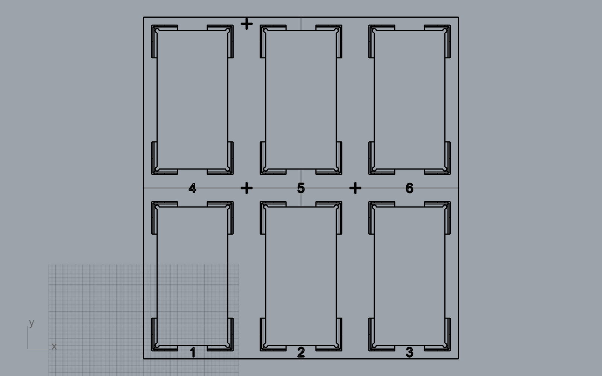

# Brick pickup tray

A minimal 3D-printed tray that puts the **6 bricks** (50 × 50 × 100 mm, lying flat) in exactly the same place every time, so the robot always knows where to pick them up.

## Files
| File | What it is |
| --- | --- |
| `pickup_tray_bricks_1-6.stl` | **Print this.** 232 × 252 × 12 mm, fits the Bambu A1 bed (256 × 256 mm) |
| `pickup_tray_bricks_1-6.3dm` | Rhino model |
| `test_fit_clearance_0.5-1.0-1.5.stl` | **Print this first:** three small frames (0.5 / 1.0 / 1.5 mm play per side, engraved on each). Try real bricks in each |
| `make_tray.py` | Script that generates everything. Change the numbers at the top, then in Rhino 8 run `RunPythonScript` on it |
| `make_tray_log.txt` | Output of the last run: size, volume, **pocket and cross coordinates** |
| `preview_*.png` | Pictures of the model |

## Design (minimal, low filament)
- A **thin 1.6 mm frame** with **open windows**: the bricks stand **directly on the table**, not on plastic.
- **L-shaped corner pieces** (4 mm thick, 12 mm high) hold each brick at its 4 corners. A **3 mm 45° lead-in** on the inside top edge funnels the brick into place.
- The middle of every side is **open** (22 mm on the short sides, 62 mm on the long sides), so the soft gripper's fingers can reach in from any direction.
- Pocket = brick + **1.0 mm play per side** (52 × 102 mm). Timber varies and wood swells, and 3D-printed inside sizes come out slightly small; 0.5 mm per side risked jamming. The brick can still only shift ±1 mm, which the soft gripper tolerates easily. Small round **reliefs in the inside corners** so brick corners don't catch.
- **Numbers 1–6** engraved in the frame in front of each pocket = brick IDs the app sends to the robot.
- **3 crosshair marks** on the frame: shared reference points. Teach them to the robot once (jog the tool tip onto each cross) and touch the same crosses for the AR calibration.
- About **76 cm³** of material if printed solid (~94 g PLA); much less with normal infill.

## Printing (Bambu A1, PLA)
- Layer height 0.2 mm, 3 walls, 15 % infill, **no supports** (all slopes are 45°). Flat side down.
- **Check the fit first:** print the test frames (~25 cm³ if solid, about an hour), drop a real brick into each and lift it out. Pick the smallest clearance where it drops in and comes out freely; if that is not 1.0, change `CLEARANCE` in `make_tray.py` and regenerate (or ask Claude).

## Fixing to the table
- Double-sided (mounting) tape under the frame.
- Line the tray up against a straight edge (table edge or a ruler taped down) so it goes back in the same place if it comes loose.
- If the tray moves, the robot positions must be taught again.

## Coordinates (from `make_tray_log.txt`, mm from the tray's front-left corner)
| Brick | x | y |
| --- | --- | --- |
| 1 | 36.0 | 61.0 |
| 2 | 116.0 | 61.0 |
| 3 | 196.0 | 61.0 |
| 4 | 36.0 | 191.0 |
| 5 | 116.0 | 191.0 |
| 6 | 196.0 | 191.0 |

Calibration crosses (top of frame, 1.6 mm high): (76, 126), (156, 126), (76, 247).
Pocket spacing is exactly **80 mm** (x) and **130 mm** (y), so once the robot knows one pocket it can compute the others.
Bricks 1–3 are the front row (y = 0 side of the tray).

## Still unknown
- Gripper finger size → the open sides (22 mm on the short sides, 62 mm on the long sides) may need to be wider once Matthias knows the gripper.
- Real brick tolerances → measure before printing.
